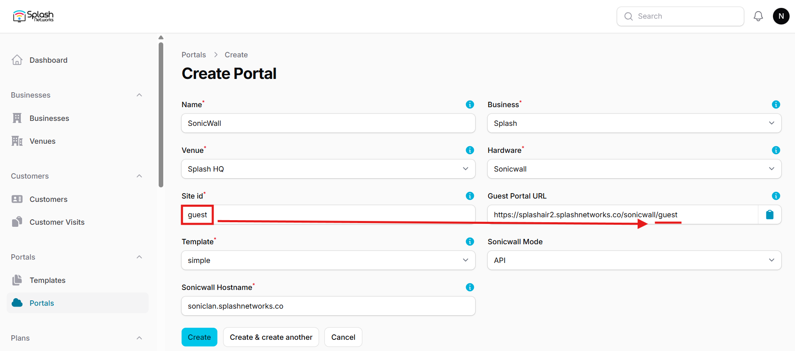
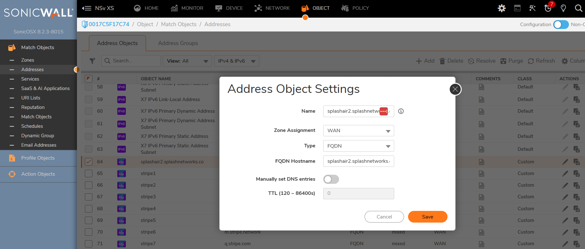
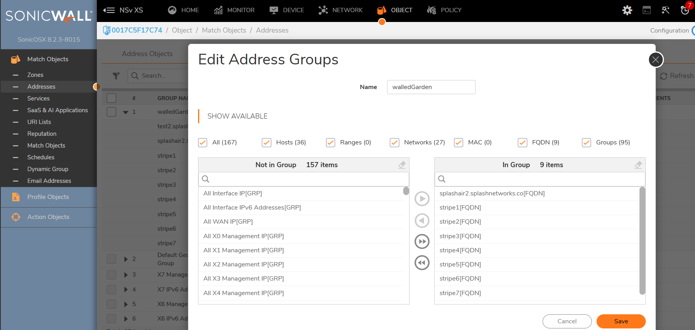
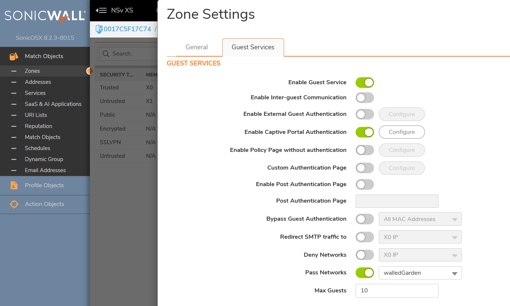
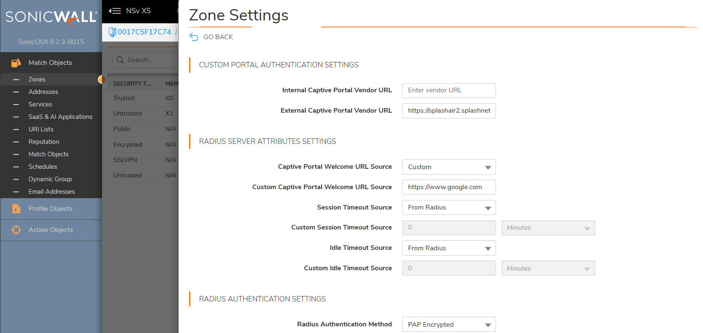
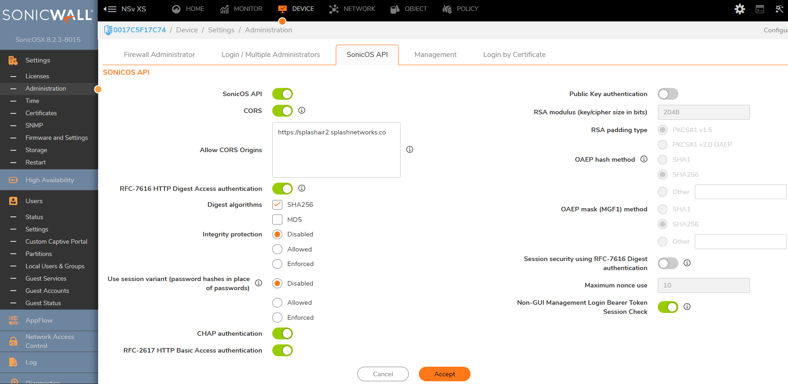
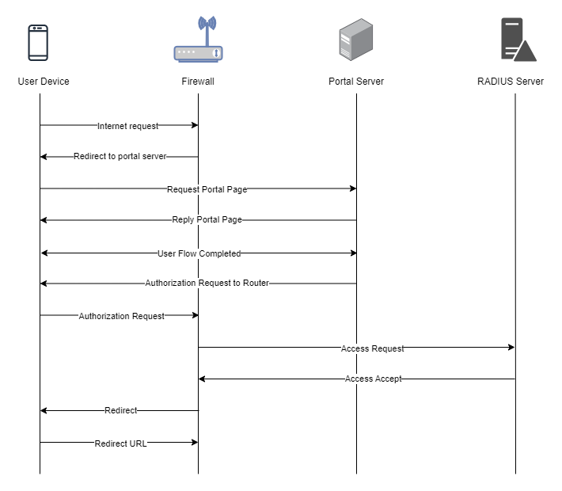

*For SonicWall versions below 7.3.2 click [here](sonicwall.md).*

To set up a portal for SonicWall first you need to [create a template](../defining-templates.md).

## Add a Portal

To create a portal go to the Portals tab and click on the New portal button. Enter a name for the portal and specify the business and venue. In Hardware select `Sonicwall`. Then, enter a Site ID based on which the path of the portal URL will be defined.



The `Guest Portal URL` will be created based on the URL of the Splash Air application followed by the path given by Site ID. Note this URL as it will be required later.

Sonicwall Mode will be `API`. In `Sonicwall Hostname` enter the hostname for the LAN interface of Sonicwall (on which captive portal will be enabled). A DNS entry for this hostname pointing to the interface IP address must exist.

Select the template and click on the Create button.

## Portal Settings

You can go to Portals to view the settings for the portal(s) just added.

Clicking on a portal takes you to the details for that portal. It lets you specify additional settings:

```
Business Name: name of the venue which will be displayed on top of the portal
Expiry: the time in days after which a repeat user will have to enter their data again on the portal
Redirect URL: the URL a user is redirected to after successful portal authorization
Duration (seconds): the time for which a user is authorized on the network
Duration (seconds) after email verification: when using "Link" type Flow it is the time for which a user is authorized on the network after successful email verification 
```

You can click on the Edit button against each entry to modify it if needed.

## SonicWall Settings

Access SonicWall firewall appliance using web interface.

Go to Device > Users > Settings > Authentication. In **User authentication method** select `RADIUS + Local Users`. Then click on the **Configure RADIUS** button and add a new RADIUS server. The IP address and RADIUS secret shared by Splash Networks' support team will be entered here. In **RADIUS Users** tab the "Default user group to which all RADIUS users belong" should be `Guest Services`. In RADIUS Attributes enable "WISPr Bandwidth Max Up" and "WISPr Bandwidth Max Down" attributes.

Then, go to Network > System > Interfaces and then Edit the LAN interface (the one on which portal will be enabled) and in **Management** enable `HTTPS`.

Next, an entry based on the Guest Portal URL noted earlier will be added. Suppose the Guest portal URL is: `https://splashair2.splashnetworks.co/sonicwall/guest`. It consists of 2 sections:

 - _Hostname_: `splashair2.splashnetworks.co`

 - _URL_: `sonicwall/guest`

Go to Object > Match Objects > Addresses > Address Objects and add a new entry:

**Name**: A friendly name

**Zone Assignment**: `WAN`

**Type**: `FQDN`

**FQDN Hostname**: the hostname as given in the example above

**Manually set DNS entries**: disabled

Save and exit.



If using `Payment` Flow you need to add [walled garden](../walled-garden.md) entries for your payment gateway such as Stripe in a similar way as given above. Then go to Address Group, create a new address group and add these entries to it.



Then go to Object > Match Objects > Zones and edit the zone on which you want to enable guest portal (such as LAN). In Guest Services use these settings:

**Enable Guest Service**: enabled

**Enable External Guest Authentication**: disabled

**Enable Captive Portal Authentication**: enabled

**Max Guests**: based on your requirements

**Pass Networks**: enabled - and select the address/address group created in the previous step



Then click on the Configure button next to `Enable Captive Portal Authentication`. In Guest Services use these settings:

**External Captive Portal Vendor URL**: the `Guest Portal URL` created earlier

**Captive Portal Welcome URL Source**: `Custom`

**Custom Captive Portal Welcome URL Source**: the URL a user should be redirected to after successful portal authorization

**Radius Authentication Method**: `PAP Encrypted`

Optionally, if you want to set **Session Timeout** and **Idle Timeout** you can configure those here.



Save the settings. Then, go to Device > Settings > Certificates and import a TLS certificate for the LAN interface - the interface on which portal is enabled, corresponding to the Sonicwall Hostname in Portal settings. This is a mandatory step, portal authentication will not work without it. Afterwards, go to Device > Settings > Administration > Management and select your uploaded certificate in **Certificate Selection**. A reboot will be necessary at this point.

Finally, go to Device > Settings > Administration > SonicOS API. Enable **SonicOS API** and **RFC-2617 HTTP Basic Access authentication**. Also enable **CORS** and in **Allow CORS Origins** enter https://<hostname\>



## Troubleshooting

To troubleshoot problems it is important to understand the components involved in the captive portal user authorization process and the interactions between them.

### Traffic Flow

Here is the traffic flow in the case of SonicWall firewall:


